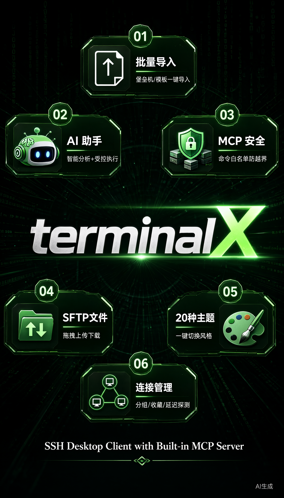

# terminalX

基于 Electron + Vue 3 的 SSH 桌面客户端：多标签分屏终端、SFTP 文件工作区、AI 助手与内置 MCP Server。



## 下载

安装包随 GitHub Release 发布，直接下载即可：

| 平台 | 文件 | 说明 |
| --- | --- | --- |
| macOS (Apple Silicon) | [terminalx-1.0.0.dmg](https://github.com/Lee330-dotcom/terminalx/releases/download/v1.0.0/terminalx-1.0.0.dmg) | 拖入「应用程序」即可 |
| Windows (x64) | [terminalx-setup-1.0.0.exe](https://github.com/Lee330-dotcom/terminalx/releases/download/v1.0.0/terminalx-setup-1.0.0.exe) | 向导式安装，可自选目录 |

全部历史版本见 [Releases 页面](https://github.com/Lee330-dotcom/terminalx/releases)。也可以按下面的[打包](#打包构建)步骤自行构建。

## 功能特性

### SSH 终端

- 基于 [ssh2](https://github.com/mscdex/ssh2) + [xterm.js](https://xtermjs.org/) 的交互式终端，支持终端内搜索（`@xterm/addon-search`）与自适应布局（`@xterm/addon-fit`）
- **多标签 + 分屏**：一个工作区里开多个终端标签，单个标签可再分屏成多个窗格
- 连接管理：分组、收藏、延迟探测、批量导入（堡垒机 / 模板两种格式）
- 凭据安全存储：主密钥由 Electron safeStorage（macOS 上为 Keychain）托管，各凭据使用 AES-256-GCM 加密落盘（`src/main/store/credentialVault.ts`）
- **主机指纹校验**：按 OpenSSH known_hosts 语义记录并校验主机公钥，指纹变化时弹窗确认，支持导入已有 known_hosts

### SFTP 文件工作区

- 远程目录浏览、上传、下载，连接后文件工作区直接出现在终端右侧
- 按文件名在远程目录树中递归搜索
- **传输记录**：下载/上传留痕落盘，可按方向筛选、重新定位本地文件、单条删除或整体清空

### 快捷命令（Snippet）

- 把常用命令整理成分组库，命令面板 / 右键菜单一键下发
- 命令支持 `{name}` 占位符，填写参数后写入终端输入区
- 是否自动回车由每条命令单独决定，默认只写入不执行

### AI 能力

- **只读分析**：选段解释、会话摘要、连接诊断、命令建议，全过程不向终端写入任何内容
- **全自动助手**：内置 Agent 支持工具调用（Tool Calling），可读取终端会话、在远程主机执行命令；写操作必须人工审批后才执行
- 命令策略管控（`src/main/ai/commandPolicy.ts`）：只读白名单可自动执行，其余一律走审批
- 输出截断保护：单次命令输出 50KB 预算，stdout/stderr 保留头尾、中间省略
- **对话历史**：每轮对话自动留痕，可回看、删除或整体清空

### 内置 MCP Server

应用内启动一个 MCP（Model Context Protocol）HTTP 服务（Streamable HTTP Transport），供外部 AI 工具接入，暴露以下工具：

| 工具 | 说明 |
| --- | --- |
| `list_connections` | 列出已配置的 SSH 连接 |
| `list_sessions` | 列出当前活跃会话 |
| `exec_command` | 在远程主机执行命令 |
| `read_terminal` | 读取终端当前输出 |
| `sftp_list` | 列出远程目录 |
| `sftp_upload` | 上传文件到远程主机 |
| `sftp_download` | 从远程主机下载文件 |

服务端口与令牌在「设置 → MCP」中配置，可一键启停、导出/导入设置。

### 界面

- 浅色 / 深色 / 跟随系统三种外观模式，终端配色与界面同步切换
- 主题色、背景色、导航栏颜色、界面字体、窗口透明度、界面缩放均可配置
- 界面语言支持简体中文与英文

## 技术栈

- **框架**：Electron + electron-vite + Vue 3 + TypeScript
- **UI**：Element Plus + Pinia
- **核心依赖**：ssh2、@xterm/xterm、@modelcontextprotocol/sdk
- **测试**：Vitest（单元测试 + E2E）

## 快速开始

### 环境要求

- Node.js ≥ 20
- npm

### 安装

```bash
$ npm install
```

### 开发

```bash
$ npm run dev
```

### 测试

```bash
# 单元测试
$ npm test

# 监听模式
$ npm run test:watch

# E2E 测试（先构建再跑）
$ npm run test:e2e
```

### 代码检查与类型检查

```bash
$ npm run lint
$ npm run typecheck
```

### 打包构建

```bash
# Windows
$ npm run build:win

# macOS（产出 dmg）
$ npm run build:mac

# Linux
$ npm run build:linux

# 仅构建、不打包安装包（用于本地验证）
$ npm run build:unpack
```

在 macOS 上打包需要设置镜像源：`export ELECTRON_MIRROR=npmmirror`。

打包产物手动验证脚本见 `src/e2e/verify-*.manual.ts`（覆盖 dmg、MCP、设置、UI、传输记录）。

## 项目结构

```
src/
├── main/        # Electron 主进程
│   ├── ai/      # AI Agent 服务、命令策略、提示词
│   ├── mcp/     # 内置 MCP Server
│   ├── ssh/     # SSH 连接管理、会话管理、SFTP、延迟探测
│   └── store/   # 连接配置、凭据库、设置、传输记录、对话历史
├── preload/     # 预加载脚本
├── renderer/    # 渲染进程（Vue 3 + Element Plus）
├── e2e/         # E2E 测试与打包产物手动验证脚本
└── shared/      # 主/渲染进程共享类型
```

## 需求与变更管理

项目采用 [OpenSpec](https://github.com/Fission-AI/OpenSpec) 管理需求与实现：每个需求一个 `openspec/changes/<name>/` 变更目录，包含 `proposal.md`、`design.md`、`specs/` 与 `tasks.md`，实现完成后归档到 `openspec/changes/archive/`。

## License

MIT
